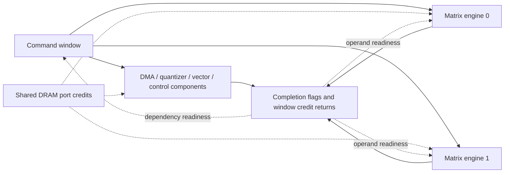

# Component model and architecture experiments

The functional prepass resolves the instruction stream, values, effective
addresses and memory footprints. LPN components then consume commands and
resource tokens to determine timing. No RTL timestamps drive the simulation.

`compact.py` connects the command window and completion tracker to the
components in `components.py`. Each `ExecutionUnit` owns its availability
place. Each `MatrixEngine` owns its command credits, prefetch credit, request
queue, ready FIFO, buffer credits and compute credit. Engine instances share
DRAM port credits and the command/dependency interface. There are no global
previous-matrix prefetch/issue flags linking engine instances.



Within each matrix engine:

```text
command admission -> prefetch request -> ready FIFO -> systolic row/batch service
                         |                                  |
                  shared DRAM ports                  pipeline/epilogue tail
                                                            |
                                               completion + command/window credits
```

Matrix admission takes commands in program order across the engine pool.
This prevents filling an engine FIFO with younger work waiting on an older
command that has not been admitted. It does not wait for the older command
to finish: available engines can prefetch and compute concurrently. An engine
admits its next command when its own previous command finishes prefetching.
Its compute credit returns at the service interval; result completion and
command/window credits include the pipeline tail.

The indexed dependency builder models RAW, WAR and WAW conflicts over DRAM,
TMEM and ACT footprints, plus barriers and HALT drain. With multiple matrix
engines, MM-to-MM conflicts become explicit completion dependencies because
engine-local FIFO order cannot synchronize separate engines. The single-engine
RTL model relies on its in-order matrix pipeline for same-engine hazards.
Other units retain their existing ordering and timing contracts.

## Run the same stream with a different engine count

```sh
PYTHONPATH=. ../FeSens-openTPU/.venv/bin/python -m examples.opentpu.run \
  --opentpu-root ../FeSens-openTPU --input /path/to/input-bundle \
  --compact --matrix-engines 2 --batch-rows 8 --emit /tmp/two-engines.mlir \
  --lpn-compiler build/tools/lpn-compile/lpn-compile --output /tmp/two-engines
/tmp/two-engines --stats --wall-start=begin --wall-end=complete
```

The engine-count knob belongs to the timing architecture (`Timing`), not the
functional ISA configuration. Numerical execution and input instructions are
unchanged. The hypothetical engines share the modeled ACT/TMEM and DRAM ports;
extra physical memory ports, banks or different arbitration need corresponding
resource changes. Existing Verilator measurements validate one engine only.

`model.statistics()` reports declared places and transitions, separately from
the number of executed instructions. For the saved 5,811-instruction SmolLM2
prefill step, the original net had 14 transitions and 186 places. The refactor
has 14 transitions and 151 places: 91 completion-flag banks, 32 command slots,
and 28 remaining queue/resource/control places. A second engine adds three
transitions and six places, giving 17 transitions and 157 places for that trace.
Counts grow with slice count, command-window size and completion-flag banks.

The optional [reusable timing interface](NATIVE_INTERFACE.md) fixes a command
capacity instead of sizing flags for one stream. With capacity 8192, one
engine uses 15 transitions and 190 places: 129 flag banks, 32 command slots,
and 29 other places. Its extra transition/place initializes buffer credits
from runtime metadata once per simulation. This extra capacity allows changing
command counts without recompiling.

On that same frozen trained-model step, both binaries predict 2,238,884 cycles.
Three alternating samples after warmup measured median native timing time
2.367 s before and 1.244 s after the refactor, a 1.90x improvement. This is
timing-core performance, with preprocessing and compilation excluded, measured
alongside the existing long RTL run. The [report](validation/component_refactor/comparison.json)
records samples and input/binary hashes.

Tests compare single-engine native/Python predictions to the expanded model
and recorded RTL fixtures. Additional cases check multi-engine overlap,
RAW/WAR/WAW dependencies, barriers, admission order and zero-rollbacks native
execution. Matching those tests does not establish accuracy for a new RTL
architecture; validate representative modified-RTL cases for that purpose.

## Running the simulator on multiple CPU cores

The current scheduler is sequential. Hardware components already overlap in
simulated time. Running their host code concurrently is a separate scheduler
change: guard reads, token takes, resource arbitration and zero-delay messages
must preserve causality and deterministic results.

This single-slice net has few transitions and strongly shared command-window,
completion and memory state. One thread per transition is unlikely to pay for
its synchronization cost. That is an assessment, not a measured parallel
speedup. Independent design points can run in separate processes immediately.
For a large multi-engine/multi-slice net, conservative parallel event processing
could partition components and advance each only while incoming events cannot
change its results; useful lookahead and coarse event batches matter. See the
[parallel simulation overview](https://www.informs-sim.org/wsc17papers/includes/files/019.pdf).
This refactor does not change the scheduler or its event ordering.
