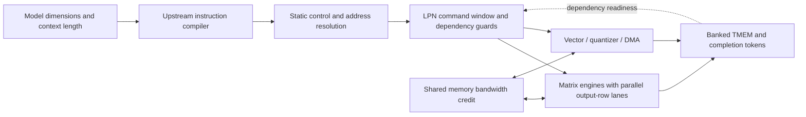
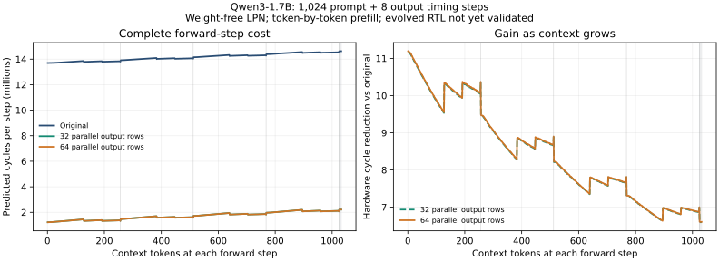

# Weight-free FPGA architecture exploration

**Workload correction:** the studies below used a custom token-by-token prompt
loop, including a vocabulary-head execution at every prompt position. They are
historical architecture microbenchmarks, **not results for openTPU's normal
inference workload**. Their 11x/8.23x reductions must not be used to claim normal
end-to-end inference speedup. LPN models hardware; upstream inference code must
own batching, tiling and decode order. Use
[standard_inference.py](standard_inference.py), which calls the unmodified
upstream `Engine.generate()`, for the corrected shared-backend path described
in [README.md](README.md). A 32-row, 64-lane architecture is now implemented
and validated in actual RTL on SmolLM2-135M with 128 prompt / 32 output tokens:
8.605x fewer cycles, identical inputs and bit-exact full device memory. See
[the implementation and audited results](rtl_evolution/README.md). The Qwen
sweeps below remain predictions rather than new modified-RTL validations.
The archived microbenchmark results used revision `bc97ee3`; later vector timing
and dependency fixes can change predictions when those historical streams are rerun.

`fpga_dse.py` compiles Qwen3-1.7B dimensions into real upstream openTPU
instructions, resolves their static scalar loops/register addresses, and feeds
the command footprints into the existing event-driven LPN. It loads no
checkpoint, tokenizer, DRAM image or numerical tensor. Matrix, quantizer and
vector instructions contribute timing and dependencies without executing their
arithmetic. This is different from `replay_e2e --timing-only`, which still
executes the numerical model and only skips RTL input-file validation.

The workload includes all 28 transformer layers, attention, KV-cache traffic,
MLP and vocabulary head. Sequence length is prescribed: this mode predicts
timing, not generated text, logits or EOS. Prefill remains token-by-token.
Data-dependent control such as RLD/WAITW is rejected; it requires supplied
control metadata or actual functional execution, not invented readiness.



## Reproduce the historical microbenchmark

Build LPN using the root README, and install NumPy in the environment for the
pinned FeSens checkout described in [README.md](README.md). Verilator and model
weights are not required for this experiment. Run from the repository root:

```sh
PYTHONPATH=. PYTHONDONTWRITEBYTECODE=1 OPENBLAS_NUM_THREADS=1 OMP_NUM_THREADS=1 \
  ../FeSens-openTPU/.venv/bin/python -m examples.opentpu.fpga_dse \
  --opentpu-root ../FeSens-openTPU \
  --compiler build/tools/lpn-compile/lpn-compile \
  --matrix-columns 1 --output /tmp/qwen17-fpga-dse
```

The default first sweeps a complete forward step at position 15, then compares
the fastest screened candidate with the original architecture for a fixed
16-input/8-output sequence (24 steps). `--matrix-columns 4` retains the original
stationary width in evolved candidates; the original baseline always keeps
four columns. Narrower arrays replay multi-row operands across more groups,
and can spend the saved compute resources on more parallel output rows. The
instruction stream and logical memory layout remain unchanged.

Use `--position 1023 --skip-sequence` for a forward step at a 1,024-token
context. CLI options expose assumed clock, memory latency, HBM efficiency,
resource reserves and MACs per DSP. Every report separates hardware cycles,
assumed-clock hardware seconds and simulator wall time. Reports include source
and compiler hashes; output directories should be separate for each study.

For the **historical token-by-token 1,024-input + 8-output microbenchmark**, use the resumable sequence
runner. It compares the original architecture with both 32-row and 64-row
narrow-array candidates at every position:

```sh
PYTHONPATH=. PYTHONDONTWRITEBYTECODE=1 OPENBLAS_NUM_THREADS=1 OMP_NUM_THREADS=1 \
  ../FeSens-openTPU/.venv/bin/python -m examples.opentpu.sequence_timing \
  --opentpu-root ../FeSens-openTPU \
  --compiler build/tools/lpn-compile/lpn-compile \
  --prompt-tokens 1024 --output-tokens 8 --workers 16 \
  --output /tmp/qwen17-sequence-1024
```

Each kernel drains at HALT, so its fixed-position timing can be simulated in an
independent host process; total hardware cycles sum the kernel cycles. This
does not add threads to the LPN scheduler or overlap tokens on the modeled
hardware. Prefill remains token-by-token, with weights streamed for each token;
this is not a benchmark of tiled multi-token prefill. Model values and EOS do
not affect this prescribed-length dense trace.

`steps/<position>.json` stores each completed position atomically. `progress.json`
reports completion counts and the owning PID. Repeat the same command to resume;
`--workers` may change, but model/compiler/runtime/upstream source fingerprints,
architecture parameters and lengths must match. A lock prevents duplicate runs
in the same directory. Each worker reuses its small timing-table scratch files
and all workers share a locked compilation cache. Summed worker times differ
from parallel wall time; the final report records both. The 1,032-step workload
uses KV capacity 1,152, beyond the capacity of the original RTL-validation run.

The original 128-token-capacity configuration checks its program hashes and
predicted cycles against the checked-in RTL-validated Qwen baseline. The
16-input/8-output study checks every original-architecture step. Evolved
architecture timing is a prediction; it has not been validated against evolved
RTL. Longer-context original-architecture predictions also extend beyond the
recorded 128-token-capacity validation campaign.

## Provisional hardware envelope

The reference is AMD's
[Alveo V80 product brief](https://www.amd.com/content/dam/amd/en/documents/products/accelerators/alveo/v80/alveo-v80-product-brief.pdf):
32 GB HBM2e, 10,848 DSP slices, 673 Mb embedded memory and 810 GB/s peak
bandwidth. The model uses a common **assumed 200 MHz** clock, **64-cycle**
memory latency, at most **70% of peak HBM bandwidth**, **80% of DSPs** for
the MXU screening estimate, and **50% of embedded memory** for the modeled
storage lower bound. These are explicit planning assumptions, not measured
board behavior or a selected bitstream. One INT8 MAC lane per DSP is assumed;
`--macs-per-dsp` makes that assumption visible rather than treating MAC lanes
as an exact mapped DSP count.

The resource screen charges replicated activation storage, matrix FIFOs,
accumulation pipelines, TMEM capacity and modeled MAC lanes. Passing this screen
does not establish total DSP/LUT use, shell availability, routing, banking
overhead, power or achievable Fmax. Those require synthesis and implementation.
HBM bank conflicts and controller behavior are not modeled; effective bandwidth
and latency should be calibrated later.

## What changes in the LPN

Each matrix engine remains an independently synchronized component. Parallel
output-row lanes replicate its datapath; compute time rounds partial groups
up. Wider memory service shares one credit across matrix prefetch and DMA/QST
traffic. Scale bytes are charged to that bus, and readiness waits for both
weight transfer and scale decoding. No weights are assumed permanently cached
on chip. Banked output service counts writes to each actual modulo-addressed
TMEM bank, including strided collisions and partial batches.

The command-prefetch credit returns only after both the data transfer and scale
decoder finish. Returning it after data alone lets a later unscaled command
overtake an older scaled batch, potentially deadlocking the engine's ready FIFO.
A 1,024-context/four-engine regression reproduced that failure before the fix
and completes with zero rollbacks afterward.

Vector/quantizer width changes `Config.LANES`. Packed QST stores, scale decoding
width, FIFO capacity and physical stationary columns are explicit architecture
choices. Multiple engines preserve inter-engine RAW/WAR/WAW dependencies.
The existing single-engine timing defaults, guards, heartbeat cache and
sequential event-driven scheduler are retained. Eighteen integration tests
passed, including original recorded RTL fixtures, static versus numerical
footprints, rejected dynamic control, bank collisions and expanded/native
agreement for the new datapaths.

## Measured LPN predictions

These are hardware-cycle reductions at the same assumed clock, compared with
the original LPN architecture. They are not measured FPGA or simulator speedups.
Short context means one complete forward step at position 15; long context means
position 1023. The original short-context program/cycles match the saved baseline.

| Physical array | Parallel output rows | Modeled MAC lanes | Assumed memory GB/s | Short-context cycle reduction | 1,024-context cycle reduction |
| --- | ---: | ---: | ---: | ---: | ---: |
| 128 x 4 (original) | 1 | 512 | 25.6 | 1.00x | 1.00x |
| 128 x 1 | 8 | 1,024 | 204.8 | 6.03x | 4.67x |
| 128 x 1 | 16 | 2,048 | 409.6 | 9.47x | 6.37x |
| 128 x 1 | 32 | 4,096 | 563.2 | 11.02x | 6.99x |
| 128 x 1 | 64 | 8,192 | 563.2 | 11.04x | 7.00x |

For **16 input + 8 output tokens**, the original architecture takes
**328,851,748 cycles**. The fastest narrow-array candidate takes
**29,675,852 cycles: 11.08x fewer**. The four-column candidate takes
34,627,828 cycles (9.50x fewer). Every one of the 24 original-architecture
steps reproduces the saved program hash and predicted cycles. This checks the
weight-free frontend against the validated model; it does not validate new RTL.

A practical first candidate is **32 output-row lanes of 128 x 1**, with a
64-lane vector/quantizer datapath and 563.2 GB/s effective memory bandwidth.
It uses 4,096 modeled MXU MAC lanes and is only 0.206% slower than doubling that MAC
budget to 8,192 lanes. The fixed clock, effective HBM throughput and all mapped
resource assumptions must be tested in synthesis/implementation. The current
256-byte/cycle packed QST path and scale decode width must also be implemented.

Keeping the original memory bandwidth while adding compute yields little gain.
Keeping the original compute while widening memory also yields little gain.
The balanced points change output-row parallelism, vector/quantizer width,
FIFO storage and memory bandwidth together. With longer context, attention and
other shared/control costs reduce the benefit to about 7x in this study.

[Four-column sweep and full sequence](validation/fpga_dse/qwen17_v80_4cols.json),
[narrow-column sweep and full sequence](validation/fpga_dse/qwen17_v80_1col.json),
[1,024-context sweep](validation/fpga_dse/qwen17_v80_context1024.json),
[test log](validation/fpga_dse/tests.txt), and
[artifact summary](validation/fpga_dse/summary.json) preserve the measurements.

The evolved 24-step simulation took about
56.8 s of preparation/compile/native-process time, plus
5.9 s of shape compilation, with other study processes running. Those
host times exclude the architecture sweep, baseline comparisons and Python
startup. No matrix arithmetic or weight loading occurred.

## Historical token-by-token 1,024-input + 8-output microbenchmark

The full prescribed sequence completed: **1,032 positions and 3,096 native LPN
simulations**, including all three architectures at every position. All had zero
rollbacks. The comparison took **15m13s wall time with 16 worker processes**.

| Architecture | Total hardware cycles | Full-workload cycle reduction | Final 8 output-step cycle reduction |
| --- | ---: | ---: | ---: |
| Original | 14,595,614,900 | 1.000x | 1.000x |
| 32 parallel output rows | 1,777,110,321 | 8.213x | 6.595x |
| 64 parallel output rows | 1,774,470,465 | 8.225x | 6.603x |

The 32-row candidate is only 0.149% slower overall while using half the modeled
MXU MAC lanes. This supports choosing it before doubling the matrix datapath.
The final output steps run at contexts 1,025 through 1,032 and are slower than
the earlier single-step result at context 1,024. Gains vary with emitted tile
shapes and context length; the short-context 11x result is not a universal gain.

This workload uses KV capacity 1,152. Its larger memory layout changes program
addresses, so it is not an identical-input RTL comparison. Source fingerprints,
all 1,032 checkpoint records and every cycle sum were audited; no new numerical
or RTL accuracy claim is made. A smaller
[parallel/resume smoke check](validation/fpga_dse/sequence_resume_smoke.json) reproduces
the saved original program hashes and LPN cycle counts at positions 0 and 1.



[Full report](validation/fpga_dse/qwen17_sequence1024.json),
[per-position CSV](validation/fpga_dse/qwen17_sequence1024.csv),
[compact summary](validation/fpga_dse/qwen17_sequence1024_summary.json), and
[completion audit](validation/fpga_dse/qwen17_sequence1024_audit.json).
The audit verifies model/upstream/compiler/runtime fingerprints, every saved
position, phase counts, cycle totals and the absence of RTL input dumps.

## Larger models

No weight arrays are necessary to model capacity or timing, but address width
still matters. The current trace compiler rejects a whole model image above
4 GiB per slice: the existing ISA uses 32-bit addresses. A future 27B design
needs layer/weight streaming through address windows, multiple slices, or a
wider/banked address interface, plus explicit transfers in the LPN.

Raw weights alone need about 27 GB at INT8 or 13.5 GB at 4-bit. Quantization
metadata, KV capacity, scratch space and controller/shell reservations must be
added before claiming that the model fits 32 GB. The first implementation here
uses the already validated 1.7B model dimensions; it does not claim a 27B run.
